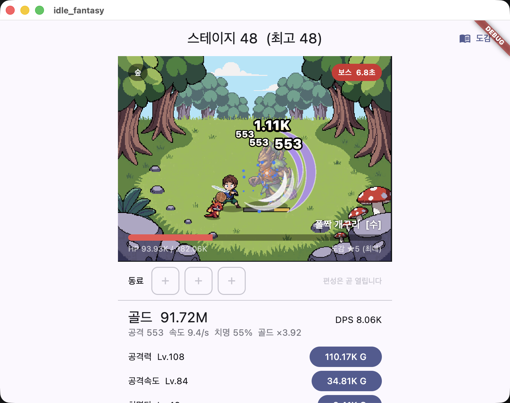
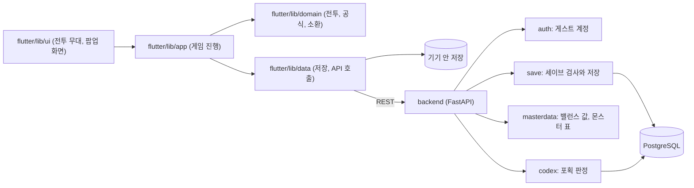

# app.game.demo

켜 두기만 해도 주인공이 자동으로 싸우며 자라고, 싸우는 도중 몬스터를 직접 잡아 도감을 채우는 모바일 방치형 판타지 게임의 데모입니다. 제가 기획한 게임을 Flutter 앱과 FastAPI 서버로 만들었습니다.

상태: 개발 멈춤 (마지막 커밋 2026-09-06). 스토어에 내지 않았고 서버도 배포하지 않았습니다. 기획 전체는 [`GAME_DESIGN.md`](GAME_DESIGN.md)에 있습니다.



## 한눈에 보기

| 항목 | 내용 |
| --- | --- |
| 기간 | 2026-09-03 ~ 2026-09-06 (main 브랜치 첫 커밋과 마지막 커밋 기준, 커밋 164개) |
| 인원과 역할 | 1인. 게임 기획, 클라이언트, 서버, 그림 방향, 검증 |
| 상태 | 개발 멈춤, 출시 안 함 |
| 주요 기술 | Flutter, Dart, Flame, Riverpod, Python 3.13, FastAPI, SQLAlchemy 2(async), PostgreSQL 17 |

## 주요 기능

- 주인공이 몰려오는 몬스터 무리와 자동으로 싸우고, 번 골드로 능력치 5종을 올려 다음 층으로 올라갑니다. 층마다 제한 시간이 있어 막히면 아래 층으로 내려가 사냥합니다.
- 싸우다 낮은 확률로 몬스터를 잡아 100종 도감을 채웁니다. 잡혔는지는 서버가 판정하고, 도감을 채울수록 능력치 보너스가 붙습니다.
- 장비(드롭, 강화, 분해, 대장간 제작), 스킬 6종, 펫 알 부화와 용 탐험, 던전 4종이 있습니다.
- 퀘스트 60개, 7일 출석부, 하루 과제 3개로 매일 할 일을 줍니다.
- 소환석으로 유물과 정령을 뽑습니다. 확률표를 화면에 보여 주고, 일정 횟수가 지나면 결과를 보장하는 장치(천장)가 있습니다.
- 게임을 꺼 둔 동안의 보상(최대 12시간)을 받고, 게스트 계정으로 세이브를 서버에 올립니다. 서버가 닿지 않으면 기기 안 저장으로 계속 진행합니다.

광고, 결제, 아레나, 랭킹은 기획서에만 있고 아직 만들지 않았습니다([`docs/BACKLOG.md`](docs/BACKLOG.md) C3, C4, E2).

## 구조



전투는 앱이 돌리고, 서버는 저장과 판정을 맡습니다. 앱이 세이브를 올리면 서버는 지난 저장 이후의 변화가 걸린 시간 안에서 가능한 범위인지 검사합니다(`backend/apps/save/domain/validation/delta_rules.py`). 기본 밸런스 값과 몬스터 100종 표는 서버가 내려 주고 앱이 받아 둡니다. 서버 안의 앱들은 `hub` 앱을 거쳐서만 서로 협력하고, 이 규칙은 `backend/.importlinter`로 검사합니다.

## AI와 함께 만든 방식

코드는 Claude Code가 작성했고, 저는 무엇을 만들지 정하고 실제 앱을 돌려 보며 판정하는 역할을 맡았습니다. 이 저장소에는 `CLAUDE.md`가 없고, 대신 기능마다 설계 문서와 구현 계획을 먼저 쓰게 해서 에이전트를 이끌었습니다.

- **설계하고, 계획하고, 구현하고, 리뷰하고, 기록했습니다.** 설계 문서 4개([`docs/superpowers/specs/`](docs/superpowers/specs/))와 구현 계획 8개([`docs/superpowers/plans/`](docs/superpowers/plans/))가 있습니다. 계획은 태스크마다 먼저 쓸 테스트와 바꿀 파일을 적고, 태스크마다 별도 에이전트가 구현한 뒤 다른 에이전트가 리뷰합니다. 기능 브랜치가 끝나면 브랜치 전체를 다시 리뷰하고, 고친 뒤 재리뷰를 받아 병합했습니다.
- **계획과 실제 실행을 대조해 남겼습니다.** 계획 8개 중 5개 끝에 "실행 기록"이 있습니다. 예를 들어 정령 소환 계획에는 "이 계획이 틀렸던 곳" 여덟 곳을 적었습니다(`84f8fe3`). 실제와 다른 함수 이름을 추측한 것, 설계와 다르게 천장을 함께 센 것, 가드를 빼도 통과하는 테스트, 코드보다 앞서 나간 문서 같은 것들입니다. 팝업 계획에는 "계획서가 확인 없이 단언한 값"이 다섯 번 틀렸고 모두 구현 중에 잡혔다고 적었습니다.
- **커밋:** main의 커밋 164개 모두에 Claude 공동 작성자 표시(`Co-Authored-By: Claude`)가 있습니다.
- **사람이 정한 것:** 기획서의 결정 사항에는 날짜가 붙어 있습니다(몬스터 100종, 임시 그래픽을 앞당김, 스킬 구조 등, [`GAME_DESIGN.md`](GAME_DESIGN.md) 7장, 16장, 17장). 그림은 AI 이미지 도구(PixelLab)로 뽑았고, 그림체 합격 여부는 제가 판정했습니다(`2d9e139`). 남은 생성 횟수가 2장뿐일 때 무엇을 뽑을지 정한 결정은 `c12d975`에 "사용자 결정"으로 남아 있습니다. 밸런스와 몬스터 이름은 제 피드백을 받아 고쳤습니다(`23c04e1`, `c0210b4`, `4bcd081`).

## 검증

CI와 git 훅은 없습니다. 테스트와 정적 검사를 로컬에서 돌렸습니다.

| 수단 | 무엇을 보는가 | 규모 |
| --- | --- | --- |
| `flutter test` | 전투 규칙, 공식, 저장, 화면 위젯 | 테스트 파일 30개, 마지막 기록 350개 |
| `flutter analyze` | 정적 분석 | 마지막 기록 0건 |
| `pytest` | 서버 유스케이스, 세이브 검사 규칙, API 연결 | 테스트 파일 19개, 마지막 기록 79개 |
| import-linter | 서버 구조 계약 5종(계층 방향, 앱끼리 독립, 프레임워크 격리, 도메인 순수성, 허브 격리) | |

테스트 개수와 분석 결과는 [`docs/superpowers/plans/2026-09-05-summon-spirits.md`](docs/superpowers/plans/2026-09-05-summon-spirits.md)의 실행 기록에 있는 값입니다. `flutter/test/domain/wall_simulation_test.dart`는 수치 공식이 의도한 대로 성장의 벽을 만드는지 시뮬레이션으로 확인합니다.

리뷰와 테스트가 잡은 문제 몇 가지입니다.

- `b403e1d` 정령 등장 연출이 자기 화면이 아니라 맨 위 화면을 닫았습니다. 연출 도중 보상 창이 겹치면 그 창을 대신 닫고, 남은 투명한 연출이 모든 입력을 막아 앱을 다시 켜야만 빠져나올 수 있었습니다. 브랜치 전체 리뷰가 재현해서 잡았습니다.
- `986515c` 소환 보상 종류를 하나 늘리자, 소환과 상관없는 퀘스트 보상이 목표마다 한 가지로 굳어 버렸습니다(층 도달 퀘스트 일곱 개가 모두 입장권 1장). 다른 시스템에 생긴 회귀였고, 이를 잡는 테스트를 넣었습니다.
- `81de5fe` 뒤로 가기로 연출이 닫히지 않는지 보는 테스트가, 막는 코드를 지워도 통과하고 있었습니다. 시간을 잘게 나눠 흐르게 바꿔 실제로 회귀를 잡게 했습니다. 실행 기록에는 같은 종류의 실패가 이 작업들에서 세 번째였다고 적혀 있습니다.

## 시작하기

필요한 것: Flutter SDK(Dart 3.12 이상), Python 3.13, Docker. 앱은 서버 없이도 기기 안 저장으로 실행됩니다.

```bash
# 환경 변수 (저장소 루트). POSTGRES_PASSWORD와 JWT_SECRET을 채운다
cp .env.example .env

# DB (127.0.0.1:5440)
docker compose up -d postgres

# 서버 http://127.0.0.1:8010/docs
cd backend
python3.13 -m venv .venv && .venv/bin/pip install -r requirements-dev.txt
.venv/bin/alembic upgrade head
.venv/bin/uvicorn main:app --reload --port 8010

# 앱 (다른 터미널, 저장소 루트에서). 서버 주소는 --dart-define=API_BASE_URL=... 로 바꾼다
cd flutter && flutter pub get && flutter run -d macos
```

테스트:

```bash
cd flutter && flutter test && flutter analyze
cd backend && .venv/bin/python -m pytest -q
cd backend && PYTHONPATH=apps .venv/bin/lint-imports --config .importlinter
```

서버 앱별 역할과 명령은 [`backend/README.md`](backend/README.md)에 있습니다.

## 폴더 구조

| 경로 | 내용 |
| --- | --- |
| `flutter/` | 게임 앱. `lib/domain`(규칙), `lib/ui`(화면), `lib/data`(저장과 API), `tools/`(스프라이트 처리 스크립트) |
| `backend/` | 게임 서버. `apps/`에 hub, auth, save, masterdata, codex |
| `docs/` | 백로그, 조사 문서, 설계 문서와 구현 계획 |
| `blog/` | 개발 기록 블로그(Jekyll, 배포 안 함) |
| `GAME_DESIGN.md`, `ART_GUIDE.md` | 기획서, 그림 규격 |

## 문서

- [`GAME_DESIGN.md`](GAME_DESIGN.md) 기획서 (성장 구조, 수치 공식, 서버 역할, 마일스톤, 세계관)
- [`ART_GUIDE.md`](ART_GUIDE.md) 그림 규격과 생성 프롬프트
- [`docs/BACKLOG.md`](docs/BACKLOG.md) 남은 일 목록과 완료 표시
- [`docs/superpowers/specs/`](docs/superpowers/specs/) 설계 문서 4개 (그림 파이프라인, 크리처 그림 방향, 화면 배치, 소환)
- [`docs/superpowers/plans/`](docs/superpowers/plans/) 구현 계획 8개와 실행 기록
- [`docs/research/`](docs/research/) 시장 조사, 화면 구성 조사
- [`backend/README.md`](backend/README.md) 서버 구조와 명령
- [`blog/README.md`](blog/README.md) 개발 기록 블로그
